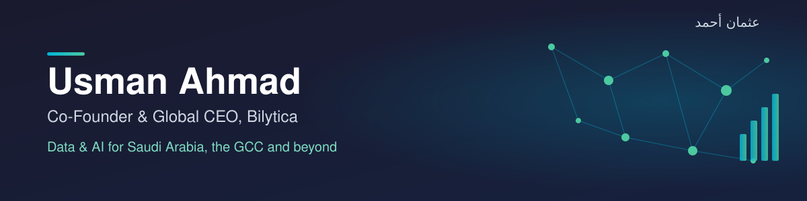

  

  
  
  
  

## About me

I've spent more than 25 years in data: first at Teradata and Accenture, and since then building companies of my own. I co-founded **[Bilytica](https://bilytica.sa)**, a data and AI company based in Riyadh with teams in Saudi Arabia, Australia and Pakistan. We help government and enterprise teams across the GCC get trusted data and put AI to work on it.

My view is simple. Most AI projects in the region don't fail because of the model. They fail because of the data under it: unclear ownership, poor quality, and Arabic that most tools still don't handle well. That's the problem I work on.

## What I work on

- **Data foundations:** data engineering, data governance, quality rules and access control for large public-sector and enterprise estates
- **Arabic-first AI:** asking business data questions in Arabic, Text-to-SQL over messy real-world schemas, and RAG over policy and legal documents
- **Agentic AI in production:** multi-agent decision support with rule engines, audit trails and role-based redaction, built for regulated environments
- **BI and analytics:** turning operational systems into decisions leaders actually use

## Open source

- **[Gulf Text-to-SQL Bench](https://github.com/usmanbilytica/arabic-text-to-sql-bench):** can an LLM turn the same business question into correct SQL when it's asked in English, Modern Standard Arabic or Gulf dialect? 30 questions × 3 variants over a Saudi public-sector database, scored by execution accuracy. Also on [Hugging Face](https://huggingface.co/datasets/usmanbilytica/gulf-text-to-sql-bench). Contributions from Gulf Arabic speakers are welcome.

## Products and ventures

| | |
|---|---|
| **Bilytica** | Data, cloud and AI for KSA, GCC and beyond. Products include Idrak (enterprise AI), Sawal (Arabic data queries), Qalumi (tender responses), Miyar (bid evaluation), Burhan (data compliance) and Watheeq (contracts) |
| **Sabeq** | AI help desk, [sabeq.care](https://sabeq.care) |
| **PayPeople** · **Ojoor** | HR and payroll technology |
| **Cloudpital** | Health-tech platform I co-founded |

## Writing and community

- I write the weekly **AI Insights** newsletter on [LinkedIn](https://www.linkedin.com/in/usmanahmad): practical notes on data and AI, with a Gulf lens
- I'm active in open-source data and AI communities and interested in Arabic NLP, data quality, open government data and evaluation of LLM systems

## Let's build together

I'm open to collaborating on Arabic language datasets and benchmarks, open data tooling for the region, and anything that makes enterprise AI more trustworthy. The fastest way to reach me is [LinkedIn](https://www.linkedin.com/in/usmanahmad).
